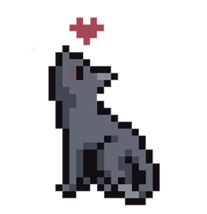

<!-- Improved compatibility of back to top link: See: https://github.com/othneildrew/Best-README-Template/pull/73 -->
<a id="readme-top"></a>

<!-- PROJECT SHIELDS -->
[![Contributors][contributors-shield]][contributors-url]
[![Forks][forks-shield]][forks-url]
[![Stargazers][stars-shield]][stars-url]
[![Issues][issues-shield]][issues-url]
[![LinkedIn][linkedin-shield]][linkedin-url]

<!-- PROJECT LOGO -->
<br />
<div align="center">
  <a href="https://github.com/createlab-univaq/pisco">
    
  </a>

<h2 align="center">PISCO</h2>

  <p align="center">
    <strong>Play-based Insight and Social Cognition</strong>
    <br />
    A serious-game platform that turns clinical social-cognition assessments into a cosy pixel-art RPG with high-precision behavioural telemetry.
    <br />
    <br />
    <a href="https://github.com/createlab-univaq/pisco"><strong>Explore the official repository »</strong></a>
    <br />
    <br />
    <a href="https://www.youtube.com/watch?v=pMbj7Mfe42c">View Video Showcase</a>
    &middot;
    <a href="https://github.com/createlab-univaq/pisco/issues">Report Bug</a>
    &middot;
    <a href="https://github.com/createlab-univaq/pisco/issues">Request Feature</a>
  </p>
</div>

> [!IMPORTANT]
> **Repository Snapshot Notice**: This repository is a personal snapshot of the PISCO project up to the last commit (`ece164527e3192cb95554e9dd775e8870f734a79` by [CarlinoCalogero](https://github.com/CarlinoCalogero)). The official, ongoing repository of the project is developed and maintained by **CreateLab at the University of L'Aquila** and is available at: **[https://github.com/createlab-univaq/pisco](https://github.com/createlab-univaq/pisco)**.

<!-- TABLE OF CONTENTS -->
<details>
  <summary>Table of Contents</summary>
  <ol>
    <li>
      <a href="#about-the-project">About The Project</a>
      <ul>
        <li><a href="#repository-architecture">Repository Architecture</a></li>
        <li><a href="#built-with">Built With</a></li>
      </ul>
    </li>
    <li>
      <a href="#core-architectural-features">Core Architectural Features</a>
      <ul>
        <li><a href="#1-dynamic-graph-driven-experiment-execution-engine">Dynamic DAG Experiment Engine</a></li>
        <li><a href="#2-sub-millisecond--physical-kinematic-telemetry-engine">Kinematic Telemetry Suite</a></li>
        <li><a href="#3-battery-of-standardized-cognitive-assessment-tasks">Cognitive Assessment Battery</a></li>
        <li><a href="#4-decoupled-multi-modal-dialogue-system">Multi-Modal Dialogue System</a></li>
        <li><a href="#5-modular-6-layer-composite-character-system">Composite Character Architecture</a></li>
        <li><a href="#6-autonomous-companion-pet-ai">Autonomous Companion AI</a></li>
        <li><a href="#7-context-aware-directional-actionable-system">Directional Actionables</a></li>
        <li><a href="#8-production-grade-networking--state-services">Networking & State Services</a></li>
      </ul>
    </li>
    <li>
      <a href="#getting-started">Getting Started</a>
      <ul>
        <li><a href="#prerequisites">Prerequisites</a></li>
        <li><a href="#running-the-components">Running the Components</a></li>
      </ul>
    </li>
    <li><a href="#usage">Usage</a></li>
    <li><a href="#contributors">Contributors</a></li>
    <li><a href="#contact">Contact</a></li>
    <li><a href="#acknowledgments">Acknowledgments</a></li>
  </ol>
</details>

<!-- ABOUT THE PROJECT -->
## About The Project

**PISCO** (*Play-based Insight and Social Cognition*) is an innovative serious game and clinical research platform developed in collaboration with **CreateLab at the University of L'Aquila (UNIVAQ)**, autism specialists, and cognitive neuroscience researchers. 

Designed to modernize cognitive evaluation and social cognition rehabilitation, PISCO transforms rigid, anxiety-inducing clinical test batteries into an inviting 2D top-down pixel-art RPG set within a virtual home.

Patients navigate their avatar, complete standardized neuropsychological protocols dynamically downloaded from a custom-made web portal DAG editor, and earn rewards to customize their home and care for a pet, while the engine transparently logs high-precision behavioral telemetry.

The platform bridges clinical rigorousness and playful engagement: psychologists define custom test flows visually on a React Flow web dashboard, while the Godot 4 client executes the graph dynamically, adapting task sequences and recording micro-behavioral metrics for diagnostic support.

* **Academic Context:** University of L'Aquila · CreateLab
* **Project Role:** Lead Game Developer, System Architect, Gameplay Programmer, 2D Pixel Artist & Animator, Co-Project Coordinator
* **Team:** 4 members (1 designer, 3 programmers)
* **Duration:** 4 months
* **Video Showcase:** [Watch on YouTube](https://www.youtube.com/watch?v=pMbj7Mfe42c)

<p align="right">(<a href="#readme-top">back to top</a>)</p>

### Repository Architecture

The PISCO ecosystem is organized as a multi-service monorepo composed of 4 key subprojects:

| Directory | Component | Primary Tech Stack | Description |
|---|---|---|---|
| [`godot-game/`](./godot-game/) | **PISCO Game Client** | Godot 4.6.3, GDScript | 2D top-down pixel-art serious game RPG client executing dynamic clinical DAG protocols and logging physical telemetry. |
| [`polyglot/`](./polyglot/) | **Protocol DAG Editor** | Next.js 16, React 19, React Flow, TypeScript | Visual workflow editor enabling psychologists to construct branching neuropsychological assessment batteries. |
| [`analyst-api/`](./analyst-api/) | **Clinical REST API** | Java 25, Spring Boot 4.1, PostgreSQL, JPA, JWT | Backend service managing analysts, patients, diagnoses, protocol code resolution, and telemetry ingestion. |
| [`dashboard-analyst/`](./dashboard-analyst/) | **Analyst Dashboard** | Svelte 5, SvelteKit 2, Vite, Chart.js | Web dashboard for clinical specialists to manage patient cohorts, monitor sessions, and analyze telemetry curves. |

<p align="right">(<a href="#readme-top">back to top</a>)</p>

### Built With

* [![Godot Engine][Godot.engine]][Godot-url]
* [![Java][Java.badge]][Java-url]
* [![Spring Boot][SpringBoot.badge]][SpringBoot-url]
* [![PostgreSQL][PostgreSQL.badge]][PostgreSQL-url]
* [![Svelte][Svelte.dev]][Svelte-url]
* [![Next.js][Next.js]][Next-url]
* [![React][React.js]][React-url]
* [![TypeScript][TypeScript.badge]][TypeScript-url]
* [![Docker][Docker.badge]][Docker-url]

<p align="right">(<a href="#readme-top">back to top</a>)</p>

<!-- CORE ARCHITECTURAL FEATURES -->
## Core Architectural Features

### 1. Dynamic Graph-Driven Experiment Execution Engine
PISCO incorporates a runtime Directed Acyclic Graph (DAG) execution engine within `ExperimentManager` that dynamically interprets clinical protocols authored by psychologists in the React Flow web portal (`polyglot`).

When a patient inputs their clinical session redemption code, the engine parses the raw JSON graph, builds adjacency dictionaries for edges and nodes, and executes in-degree root discovery to identify the starting node (the node with zero incoming edges). Tasks are dispatched dynamically using string-mapped task handlers, and conditional branching thresholds (`Operator.GREATER_EQUAL`, etc.) are evaluated based on patient score.

### 2. Sub-Millisecond & Physical Kinematic Telemetry Engine
To provide clinicians with diagnostic data beyond simple right/wrong answers, PISCO features a high-precision dual-phase behavioral tracking suite composed of `MouseDistanceTracker`, `FirstInputInterceptor`, and `Stopwatch`.

The system measures **reaction time** (cognitive hesitation before initiating any mouse movement or keypress) independently from **total response time** (duration until final choice selection). Furthermore, cursor trajectory is normalized into physical centimeters: the engine queries the operating system's display density via `DisplayServer.screen_get_dpi()`, converting pixel vectors into real-world physical motion metrics that remain scientifically comparable across different monitor sizes and resolutions.

### 3. Battery of Standardized Cognitive Assessment Tasks
The client provides digital adaptations of standardized neuropsychological assessment protocols:
* **Theory of Mind (ToM):** Multi-character narrative scenarios assessing false-belief understanding and mental state attribution.
* **Baron-Cohen Faux Pas Recognition:** Detects social blunder awareness with automated skip logic (bypassing follow-up questions if no faux pas is detected).
* **Reading the Mind in the Eyes (RMET):** Displays standardized gaze crops streamed dynamically from cloud endpoints with format sniffing.
* **Emotion Attribution & Recognition:** Open-ended and multi-choice emotional state categorization with keyword normalization.

### 4. Decoupled Multi-Modal Dialogue System
An asynchronous, queue-based dialogue system (`DialogueController`) presents multi-modal cognitive interactions. The architecture separates dialogue presentation into modular UI components:
* Typewriter-animated text boxes (`TextBox`)
* Dynamic multi-choice selectors (`ChoicesBox`)
* Free-form text input fields (`TextInput`)
* Remote image loaders (`ImageBox`) with support for `@tool` scripts for in-editor live previewing.

### 5. Modular 6-Layer Composite Character System
A 6-layer composite sprite character system (`CompositePlayer`) divides avatars into **Body**, **Face**, **Hair**, **Shirt**, **Pants**, and **Shoes**. It supports real-time gender switching and wardrobe customization through `CustomPlayerScreen`. Layer animations are synchronized across all directional `BlendTree` states in Godot's `AnimationTree`, ensuring seamless 4-directional locomotion without sprite alignment drift.

### 6. Autonomous Companion Pet AI
To reinforce the cosy, comforting atmosphere of the clinical environment, the game includes an autonomous companion pet (`BobaTheCat`). The pet operates on a 3-state Finite State Machine (`IDLE`, `FOLLOW_PLAYER`, `PET`). Steering mechanics use distance hysteresis thresholds to prevent jittery start-stop oscillations when following the player. When the player pauses and interacts, Boba transitions into the petting state, playing custom purring animations and persisting across room transitions.

### 7. Context-Aware Directional Actionable System
The `Actionable` framework manages world interactions cleanly. Interactive props (beds, wardrobes, doors, desks) utilize area triggers that detect player proximity. The system validates player facing angles using 2D vector dot products, ensuring interactions only fire when the avatar is actually looking at the object. Multiple overlapping actionables are sorted by Euclidean distance, showing a dynamic exclamation indicator over the primary target.

### 8. Production-Grade Networking & State Services
A RESTful networking layer (`APIManager`) handles communication with the PISCO clinical cloud backend using JWT Bearer authentication tokens, structured DTO serialization (`GameExecutionDTO`, `RedeemedPathResponseDTO`), and ISO-8601 UTC timestamp formatting. Upon session completion, experiment telemetry and answer records are batched and posted asynchronously, with automatic error retry handling and toast notifications.

<p align="right">(<a href="#readme-top">back to top</a>)</p>

<!-- GETTING STARTED -->
## Getting Started

To explore or run the components of the PISCO platform locally, follow the steps below.

### Prerequisites

* **Godot Engine:** Version 4.6+ ([Download Godot](https://godotengine.org/))
* **Java Development Kit (JDK):** Version 25+ ([Eclipse Temurin / OpenJDK](https://adoptium.net/))
* **Node.js:** Version 20.x or higher & npm ([Download Node.js](https://nodejs.org/))
* **Docker & Docker Compose:** For running PostgreSQL and containerized services ([Get Docker](https://www.docker.com/))

### Running the Components

For comprehensive setup guides, please refer to the dedicated README in each subfolder:

1. **Backend API (`analyst-api`):**
   ```sh
   cd analyst-api
   docker compose -f docker-compose.dev.yml up -d
   ./mvnw spring-boot:run
   ```
   *Detailed instructions:* [`analyst-api/README.md`](./analyst-api/README.md)

2. **Analyst Web Dashboard (`dashboard-analyst`):**
   ```sh
   cd dashboard-analyst
   npm install
   npm run dev
   ```
   *Detailed instructions:* [`dashboard-analyst/README.md`](./dashboard-analyst/README.md)

3. **Flow DAG Editor (`polyglot`):**
   ```sh
   cd polyglot
   npm install
   npm run dev
   ```
   *Detailed instructions:* [`polyglot/README.md`](./polyglot/README.md)

4. **Godot Serious Game Client (`godot-game`):**
   * Open the Godot 4.6 editor, click **Import**, and select `godot-game/project.godot`.
   * Press **F5** or the Play button in the top right to launch.
   * *Detailed instructions:* [`godot-game/README.md`](./godot-game/README.md)

<p align="right">(<a href="#readme-top">back to top</a>)</p>

<!-- USAGE -->
## Usage

```
                  ┌───────────────────────────────────────────────┐
                  │            POLYGLOT DAG PORTAL                │
                  │   Psychologists design cognitive test flows   │
                  └───────────────────────┬───────────────────────┘
                                          │ Exports JSON Graph
                                          ▼
┌───────────────────────┐         ┌───────────────────────────────┐
│  DASHBOARD ANALYST    │         │          ANALYST API          │
│ Clinicians track      │◄───────►│  Spring Boot REST & Telemetry │
│ patient metrics       │   JWT   │  PostgreSQL Database          │
└───────────────────────┘         └───────────────▲───────────────┘
                                                  │
                                                  │ Session Redemption &
                                                  │ Telemetry Ingestion
                                                  ▼
                                  ┌───────────────────────────────┐
                                  │       PISCO GAME CLIENT       │
                                  │    Godot 4 2D Pixel-Art RPG   │
                                  └───────────────────────────────┘
```

1. **Protocol Authoring:** A clinician designs a cognitive battery on the **Polyglot** DAG editor, setting score-based branching logic.
2. **Patient Assignment:** The clinician uses **Dashboard Analyst** to register a patient and generate a unique session `PathCode`.
3. **Gamified Execution:** The patient launches the **PISCO Game Client**, enters the redemption code, and plays through the cozy RPG scenario.
4. **Behavioral Telemetry:** The Godot client logs millisecond reaction times and DPI-normalized cursor distances, posting the payload back to the **Analyst API**.
5. **Clinical Analysis:** The clinician reviews the resulting charts, hesitation metrics, and accuracy scores in the **Dashboard Analyst**.

<p align="right">(<a href="#readme-top">back to top</a>)</p>

<!-- CONTRIBUTORS -->
## Contributors

This repository is a personal snapshot of the project and does not accept external contributions or pull requests.

A huge thank you to all the contributors who have built and supported the PISCO platform:

<a href="https://github.com/CarlinoCalogero/pisco/graphs/contributors">
  
</a>

<p align="right">(<a href="#readme-top">back to top</a>)</p>

<!-- CONTACT -->
## Contact

* **Calogero Carlino** - Game Programmer
  * Email: [carlinocalogero.dev@gmail.com](mailto:carlinocalogero.dev@gmail.com)
  * Portfolio: [https://carlinocalogero.github.io](https://carlinocalogero.github.io)
  * LinkedIn: [https://www.linkedin.com/in/calogero-carlino-2a94a33b5/](https://www.linkedin.com/in/calogero-carlino-2a94a33b5/)
  * GitHub: [@CarlinoCalogero](https://github.com/CarlinoCalogero)
* **CreateLab UNIVAQ** - [https://github.com/createlab-univaq](https://github.com/createlab-univaq)
* **Official Project Link:** [https://github.com/createlab-univaq/pisco](https://github.com/createlab-univaq/pisco)

<p align="right">(<a href="#readme-top">back to top</a>)</p>

<!-- ACKNOWLEDGMENTS -->
## Acknowledgments

* [CreateLab - University of L'Aquila (UNIVAQ)](https://github.com/createlab-univaq)
* [Autism Specialists & Cognitive Neuroscience Researchers at UNIVAQ](https://www.univaq.it/)
* [Godot Engine Community](https://godotengine.org/)
* [React Flow](https://reactflow.dev/)
* [Best-README-Template](https://github.com/othneildrew/Best-README-Template)

<p align="right">(<a href="#readme-top">back to top</a>)</p>

<!-- MARKDOWN LINKS & IMAGES -->
[contributors-shield]: https://img.shields.io/github/contributors/CarlinoCalogero/pisco.svg?style=for-the-badge
[contributors-url]: https://github.com/CarlinoCalogero/pisco/graphs/contributors
[forks-shield]: https://img.shields.io/github/forks/CarlinoCalogero/pisco.svg?style=for-the-badge
[forks-url]: https://github.com/CarlinoCalogero/pisco/network/members
[stars-shield]: https://img.shields.io/github/stars/CarlinoCalogero/pisco.svg?style=for-the-badge
[stars-url]: https://github.com/CarlinoCalogero/pisco/stargazers
[issues-shield]: https://img.shields.io/github/issues/CarlinoCalogero/pisco.svg?style=for-the-badge
[issues-url]: https://github.com/CarlinoCalogero/pisco/issues
[linkedin-shield]: https://img.shields.io/badge/-LinkedIn-black.svg?style=for-the-badge&logo=linkedin&colorB=555
[linkedin-url]: https://www.linkedin.com/in/calogero-carlino-2a94a33b5/

[Godot.engine]: https://img.shields.io/badge/Godot_4.6-478CBF?style=for-the-badge&logo=godotengine&logoColor=white
[Godot-url]: https://godotengine.org/
[Java.badge]: https://img.shields.io/badge/Java_25-ED8B00?style=for-the-badge&logo=openjdk&logoColor=white
[Java-url]: https://adoptium.net/
[SpringBoot.badge]: https://img.shields.io/badge/Spring_Boot_4-6DB33F?style=for-the-badge&logo=springboot&logoColor=white
[SpringBoot-url]: https://spring.io/projects/spring-boot
[PostgreSQL.badge]: https://img.shields.io/badge/PostgreSQL_17-316192?style=for-the-badge&logo=postgresql&logoColor=white
[PostgreSQL-url]: https://www.postgresql.org/
[Svelte.dev]: https://img.shields.io/badge/Svelte_5-4A4A55?style=for-the-badge&logo=svelte&logoColor=FF3E00
[Svelte-url]: https://svelte.dev/
[Next.js]: https://img.shields.io/badge/Next.js_16-000000?style=for-the-badge&logo=nextdotjs&logoColor=white
[Next-url]: https://nextjs.org/
[React.js]: https://img.shields.io/badge/React_19-20232A?style=for-the-badge&logo=react&logoColor=61DAFB
[React-url]: https://react.dev/
[TypeScript.badge]: https://img.shields.io/badge/TypeScript-3178C6?style=for-the-badge&logo=typescript&logoColor=white
[TypeScript-url]: https://www.typescriptlang.org/
[Docker.badge]: https://img.shields.io/badge/Docker-2496ED?style=for-the-badge&logo=docker&logoColor=white
[Docker-url]: https://www.docker.com/
