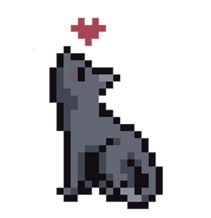

<!-- Improved compatibility of back to top link: See: https://github.com/othneildrew/Best-README-Template/pull/73 -->
<a id="readme-top"></a>

<!-- PROJECT SHIELDS -->
[![Contributors][contributors-shield]][contributors-url]
[![Forks][forks-shield]][forks-url]
[![Stargazers][stars-shield]][stars-url]
[![Issues][issues-shield]][issues-url]
[![LinkedIn][linkedin-shield]][linkedin-url]

<!-- PROJECT LOGO -->
<br />
<div align="center">
  <a href="https://github.com/createlab-univaq/pisco">
    
  </a>

<h2 align="center">PISCO — Analyst API</h2>

  <p align="center">
    <strong>High-Performance Clinical Backend Service with Virtual Threads, JWT Security, & Telemetry Ingestion</strong>
    <br />
    <br />
    <a href="https://github.com/createlab-univaq/pisco"><strong>Explore the official repository »</strong></a>
    <br />
    <br />
    <a href="https://github.com/createlab-univaq/pisco/issues">Report Bug</a>
    &middot;
    <a href="https://github.com/createlab-univaq/pisco/issues">Request Feature</a>
  </p>
</div>

> [!IMPORTANT]
> **Repository Snapshot Notice**: This directory is part of a personal snapshot of the PISCO project up to the last commit (`ece164527e3192cb95554e9dd775e8870f734a79` by [CarlinoCalogero](https://github.com/CarlinoCalogero)). The official, ongoing repository of the project is hosted and maintained at **[https://github.com/createlab-univaq/pisco](https://github.com/createlab-univaq/pisco)**.

<!-- TABLE OF CONTENTS -->
<details>
  <summary>Table of Contents</summary>
  <ol>
    <li>
      <a href="#about-the-analyst-api">About The Analyst API</a>
      <ul>
        <li><a href="#built-with">Built With</a></li>
      </ul>
    </li>
    <li>
      <a href="#core-responsibilities--features">Core Responsibilities & Features</a>
      <ul>
        <li><a href="#clinical-data-model">Clinical Data Model</a></li>
        <li><a href="#polyglot-flow-integration">Polyglot Flow Integration</a></li>
        <li><a href="#telemetry-ingestion-engine">Telemetry Ingestion Engine</a></li>
      </ul>
    </li>
    <li><a href="#api-specification-endpoints">API Specification & Endpoints</a></li>
    <li>
      <a href="#getting-started">Getting Started</a>
      <ul>
        <li><a href="#prerequisites">Prerequisites</a></li>
        <li><a href="#local-database-setup">Local Database Setup</a></li>
        <li><a href="#running-the-application">Running the Application</a></li>
        <li><a href="#configuration">Configuration</a></li>
        <li><a href="#docker-deployment">Docker Deployment</a></li>
      </ul>
    </li>
    <li><a href="#contact">Contact</a></li>
    <li><a href="#acknowledgments">Acknowledgments</a></li>
  </ol>
</details>

<!-- ABOUT THE ANALYST API -->
## About The Analyst API

The **Analyst API** is the core backend service of the PISCO ecosystem. Built with **Spring Boot 4.1** on **Java 25** with virtual threads enabled, it manages the entire lifecycle of clinical data: analyst authentication, patient cohorts, clinical diagnoses, session redemption codes, and high-frequency behavioral telemetry ingestion from the Godot game client.

The API serves as the secure junction between three distinct clients:
1. **The Analyst Dashboard:** Uses JWT-authenticated REST endpoints to manage patients, record diagnostic notes, and query aggregated session analytics.
2. **The Polyglot DAG Editor:** Interacts through path resolution endpoints to associate visual graphs with patient assessment plans.
3. **The Godot Game Client:** Redeems session `PathCode` credentials, downloads dynamic protocol graphs, and streams back real-time kinematic metrics (reaction hesitation, response latency, and normalized cursor distances).

<p align="right">(<a href="#readme-top">back to top</a>)</p>

### Built With

* [![Java][Java.badge]][Java-url]
* [![Spring Boot][SpringBoot.badge]][SpringBoot-url]
* [![PostgreSQL][PostgreSQL.badge]][PostgreSQL-url]
* [![Spring Security][SpringSecurity.badge]][SpringSecurity-url]
* [![OpenAPI][OpenAPI.badge]][OpenAPI-url]
* [![Docker][Docker.badge]][Docker-url]

<p align="right">(<a href="#readme-top">back to top</a>)</p>

<!-- CORE RESPONSIBILITIES -->
## Core Responsibilities & Features

### Clinical Data Model
* **Analysts & Patients:** Many-to-many relationship managed via `AnalystPatient` junction records, ensuring strict multi-tenant isolation so clinicians only access authorized patient profiles.
* **Diagnoses:** Detailed clinical diagnostic logs (`Text`, `Notes`, `Drugs`, `Date`) linked directly to the patient-analyst relationship.
* **Master Records:** Normalized auxiliary tables including educational attainment (`Degree`) and game cognitive task categories (`NodeType`).

### Polyglot Flow Integration
* **Protocol Assignment:** Analysts link a patient to a Polyglot DAG flow, generating a unique, cryptographically secure redemption code (`PathCode`).
* **Path Resolution:** Provides an endpoint for the Godot client to fetch the complete JSON graph corresponding to the patient's redemption code without exposing internal database structures.

### Telemetry Ingestion Engine
* **Session Tracking (`GameExecution`):** Records execution timestamps and links gameplay to specific patient redemption codes.
* **Per-Node Telemetry (`GameAnswer`):** Stores granular performance data for every traversed DAG node:
  * Initial cognitive hesitation / reaction time
  * Total task response time
  * Physical cursor trajectory distance (in normalized centimeters)
  * Patient score vs. maximum possible score
  * Traversal sequence index and node identifier

<p align="right">(<a href="#readme-top">back to top</a>)</p>

<!-- API SPECIFICATION -->
## API Specification & Endpoints

When running locally, interactive Swagger documentation is available at:  
[http://localhost:8080/swagger-ui.html](http://localhost:8080/swagger-ui.html)

### Summary of REST Endpoints

| Category | Method | Endpoint | Description |
|---|---|---|---|
| **Auth** | `POST` | `/api/auth/login` | Clinician login & JWT token generation |
| | `POST` | `/api/auth/logout` | Invalidate analyst session |
| **Analysts** | `GET` | `/api/analysts` | List registered analysts |
| | `GET` | `/api/analysts/{id}` | Get analyst profile |
| | `POST` | `/api/analysts` | Register new analyst |
| | `PUT` | `/api/analysts/{id}` | Update analyst profile |
| | `DELETE`| `/api/analysts/{id}` | Remove analyst record |
| **Patients** | `GET` | `/api/patients` | List patients under current analyst |
| | `POST` | `/api/patients` | Create patient & associate with analyst |
| | `GET` | `/api/patients/{id}` | Retrieve patient details |
| | `PUT` | `/api/patients/{id}` | Update patient demographics |
| | `DELETE`| `/api/patients/{id}` | Remove patient record |
| **Diagnoses**| `GET` | `/api/analyst-patients/{id}/diagnoses` | Fetch diagnostic history |
| | `POST` | `/api/analyst-patients/{id}/diagnoses` | Add diagnostic report & prescription |
| | `PUT` | `/api/diagnoses/{id}` | Update diagnosis |
| | `DELETE`| `/api/diagnoses/{id}` | Remove diagnosis record |
| **Paths** | `GET` | `/api/polyglot-paths` | Proxy available Polyglot test paths |
| | `POST` | `/api/analyst-patients/{id}/paths` | Assign path & generate `PathCode` |
| | `GET` | `/api/paths/resolve/{path_code}` | Resolve path JSON for Godot game client |
| **Telemetry**| `GET` | `/api/game-executions` | List session execution history |
| | `GET` | `/api/game-executions/by-path/{path_code}` | Get executions for a path code |
| | `POST` | `/api/game-executions/{id}/answers` | Ingest micro-telemetry for a node |

<p align="right">(<a href="#readme-top">back to top</a>)</p>

<!-- GETTING STARTED -->
## Getting Started

### Prerequisites

* **Java Development Kit (JDK):** Version 25 ([Eclipse Temurin](https://adoptium.net/))
* **Maven:** Version 3.9+ (or use the included `./mvnw`)
* **Docker & Docker Compose:** For running PostgreSQL 17 Alpine

### Local Database Setup

Start a local PostgreSQL 17 instance with predefined schemas:
```sh
docker compose -f docker-compose.dev.yml up -d
```
This starts PostgreSQL on port `5432` with database `analyst_dashboard` and default credentials (`analyst` / `analyst`).

### Running the Application

Run the Spring Boot application using the default `local` profile:
```sh
# On Linux / macOS
./mvnw spring-boot:run

# On Windows
mvn spring-boot:run
```
The server will start listening on [http://localhost:8080](http://localhost:8080).

### Configuration

Environment variables can be configured via `.env` or system environment variables:

| Variable | Description | Default |
|---|---|---|
| `PORT` | HTTP port the application binds to | `8080` (or `8082` in Docker) |
| `SPRING_PROFILES_ACTIVE` | Active Spring profile (`local`, `prod`) | `local` |
| `DB_URL` | JDBC Connection URL | `jdbc:postgresql://localhost:5432/analyst_dashboard` |
| `DB_USER` | Database username | `analyst` |
| `DB_PASSWORD` | Database password | `analyst` |
| `JWT_SECRET` | Secret key for signing HMAC-SHA JWTs | *(set a strong random string)* |
| `JWT_EXPIRES_IN` | Duration string for token lifespan | `PT8H` |
| `CORS_ORIGINS` | Allowed origins for web dashboards | `*` (configured per-environment) |

### Docker Deployment

To build and run the production image:
```sh
docker compose up -d
```

<p align="right">(<a href="#readme-top">back to top</a>)</p>

<!-- CONTACT -->
## Contact

* **Calogero Carlino** - Game Programmer & Systems Architect
  * Email: [carlinocalogero.dev@gmail.com](mailto:carlinocalogero.dev@gmail.com)
  * Portfolio: [https://carlinocalogero.github.io](https://carlinocalogero.github.io)
  * LinkedIn: [https://www.linkedin.com/in/calogero-carlino-2a94a33b5/](https://www.linkedin.com/in/calogero-carlino-2a94a33b5/)
  * GitHub: [@CarlinoCalogero](https://github.com/CarlinoCalogero)
* **CreateLab UNIVAQ** - [https://github.com/createlab-univaq](https://github.com/createlab-univaq)
* **Project Repository:** [https://github.com/createlab-univaq/pisco](https://github.com/createlab-univaq/pisco)

<p align="right">(<a href="#readme-top">back to top</a>)</p>

<!-- ACKNOWLEDGMENTS -->
## Acknowledgments

* [CreateLab - University of L'Aquila](https://github.com/createlab-univaq)
* [Spring Boot Community](https://spring.io/projects/spring-boot)
* [Best-README-Template](https://github.com/othneildrew/Best-README-Template)

<p align="right">(<a href="#readme-top">back to top</a>)</p>

<!-- MARKDOWN LINKS & IMAGES -->
[contributors-shield]: https://img.shields.io/github/contributors/CarlinoCalogero/pisco.svg?style=for-the-badge
[contributors-url]: https://github.com/CarlinoCalogero/pisco/graphs/contributors
[forks-shield]: https://img.shields.io/github/forks/CarlinoCalogero/pisco.svg?style=for-the-badge
[forks-url]: https://github.com/CarlinoCalogero/pisco/network/members
[stars-shield]: https://img.shields.io/github/stars/CarlinoCalogero/pisco.svg?style=for-the-badge
[stars-url]: https://github.com/CarlinoCalogero/pisco/stargazers
[issues-shield]: https://img.shields.io/github/issues/CarlinoCalogero/pisco.svg?style=for-the-badge
[issues-url]: https://github.com/CarlinoCalogero/pisco/issues
[linkedin-shield]: https://img.shields.io/badge/-LinkedIn-black.svg?style=for-the-badge&logo=linkedin&colorB=555
[linkedin-url]: https://www.linkedin.com/in/calogero-carlino-2a94a33b5/

[Java.badge]: https://img.shields.io/badge/Java_25-ED8B00?style=for-the-badge&logo=openjdk&logoColor=white
[Java-url]: https://adoptium.net/
[SpringBoot.badge]: https://img.shields.io/badge/Spring_Boot_4.1-6DB33F?style=for-the-badge&logo=springboot&logoColor=white
[SpringBoot-url]: https://spring.io/projects/spring-boot
[PostgreSQL.badge]: https://img.shields.io/badge/PostgreSQL_17-316192?style=for-the-badge&logo=postgresql&logoColor=white
[PostgreSQL-url]: https://www.postgresql.org/
[SpringSecurity.badge]: https://img.shields.io/badge/Spring_Security-6DB33F?style=for-the-badge&logo=springsecurity&logoColor=white
[SpringSecurity-url]: https://spring.io/projects/spring-security
[OpenAPI.badge]: https://img.shields.io/badge/OpenAPI_3.1-6BA539?style=for-the-badge&logo=swagger&logoColor=white
[OpenAPI-url]: https://swagger.io/
[Docker.badge]: https://img.shields.io/badge/Docker-2496ED?style=for-the-badge&logo=docker&logoColor=white
[Docker-url]: https://www.docker.com/
