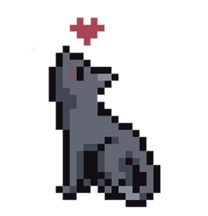

<!-- Improved compatibility of back to top link: See: https://github.com/othneildrew/Best-README-Template/pull/73 -->
<a id="readme-top"></a>

<!-- PROJECT SHIELDS -->
[![Contributors][contributors-shield]][contributors-url]
[![Forks][forks-shield]][forks-url]
[![Stargazers][stars-shield]][stars-url]
[![Issues][issues-shield]][issues-url]
[![LinkedIn][linkedin-shield]][linkedin-url]

<!-- PROJECT LOGO -->
<br />
<div align="center">
  <a href="https://github.com/createlab-univaq/pisco">
    
  </a>

<h2 align="center">PISCO — Analyst Dashboard</h2>

  <p align="center">
    <strong>Clinical Web Dashboard for Patient Cohort Management, Protocol Assignment, & Kinematic Behavioral Analytics</strong>
    <br />
    <br />
    <a href="https://github.com/createlab-univaq/pisco"><strong>Explore the official repository »</strong></a>
    <br />
    <br />
    <a href="https://github.com/createlab-univaq/pisco/issues">Report Bug</a>
    &middot;
    <a href="https://github.com/createlab-univaq/pisco/issues">Request Feature</a>
  </p>
</div>

> [!IMPORTANT]
> **Repository Snapshot Notice**: This directory is part of a personal snapshot of the PISCO project up to the last commit (`ece164527e3192cb95554e9dd775e8870f734a79` by [CarlinoCalogero](https://github.com/CarlinoCalogero)). The official, ongoing repository of the project is hosted and maintained at **[https://github.com/createlab-univaq/pisco](https://github.com/createlab-univaq/pisco)**.

<!-- TABLE OF CONTENTS -->
<details>
  <summary>Table of Contents</summary>
  <ol>
    <li>
      <a href="#about-the-analyst-dashboard">About The Analyst Dashboard</a>
      <ul>
        <li><a href="#built-with">Built With</a></li>
      </ul>
    </li>
    <li>
      <a href="#key-clinical-features">Key Clinical Features</a>
      <ul>
        <li><a href="#patient-cohort-management">Patient Cohort Management</a></li>
        <li><a href="#diagnostic-tracking">Diagnostic Tracking</a></li>
        <li><a href="#protocol-assignment--redemption-codes">Protocol Assignment & Redemption Codes</a></li>
        <li><a href="#telemetry-data-visualization">Telemetry Data Visualization</a></li>
      </ul>
    </li>
    <li>
      <a href="#getting-started">Getting Started</a>
      <ul>
        <li><a href="#prerequisites">Prerequisites</a></li>
        <li><a href="#installation--configuration">Installation & Configuration</a></li>
        <li><a href="#development-server">Development Server</a></li>
        <li><a href="#running-tests">Running Tests</a></li>
        <li><a href="#docker-deployment">Docker Deployment</a></li>
      </ul>
    </li>
    <li><a href="#contact">Contact</a></li>
    <li><a href="#acknowledgments">Acknowledgments</a></li>
  </ol>
</details>

<!-- ABOUT THE ANALYST DASHBOARD -->
## About The Analyst Dashboard

The **Analyst Dashboard** is the primary clinical interface of the PISCO platform. Engineered with **Svelte 5** and **SvelteKit 2**, it provides clinicians, psychologists, and cognitive neuroscience researchers with a responsive, high-performance web portal to manage their patients and inspect empirical session results.

By rendering granular behavioral telemetry streamed from the Godot game client, clinicians can analyze cognitive parameters that go far beyond standard paper-and-pencil tests:
* **Initial Reaction Hesitation vs. Total Response Time:** Visualizes cognitive processing delays before movement onset.
* **Kinematic Trajectory Distance:** Examines physical cursor distance in real centimeters, highlighting motor coordination and decision certainty.
* **Accuracy & Error Profiles:** Breaks down performance across Theory of Mind, Faux Pas recognition, and emotional attribution tasks.

<p align="right">(<a href="#readme-top">back to top</a>)</p>

### Built With

* [![Svelte][Svelte.dev]][Svelte-url]
* [![SvelteKit][SvelteKit.badge]][SvelteKit-url]
* [![TypeScript][TypeScript.badge]][TypeScript-url]
* [![Vite][Vite.badge]][Vite-url]
* [![Chart.js][Chartjs.badge]][Chartjs-url]
* [![Playwright][Playwright.badge]][Playwright-url]
* [![Docker][Docker.badge]][Docker-url]

<p align="right">(<a href="#readme-top">back to top</a>)</p>

<!-- KEY CLINICAL FEATURES -->
## Key Clinical Features

### Patient Cohort Management
* **Demographic Registry:** Create, read, update, and manage patients (`/patients`), structured with education levels (`Degree`), age, and gender metrics.
* **Multi-Clinician Isolation:** Secure sessions ensure clinicians only inspect patients under their care.

### Diagnostic Tracking
* **Clinical Records:** Log and maintain chronological diagnoses, notes, and medication regimes (`/patients/[id]`).

### Protocol Assignment & Redemption Codes
* **Polyglot Path Linking:** Assign visual test flows authored in Polyglot to specific patients (`/paths`).
* **Redemption Code Generation:** Produces unique alphanumeric `PathCode` tokens that patients enter directly into the Godot game client.

### Telemetry Data Visualization
* **Chart.js Integration:** Interactive bar and line charts visualizing node-by-node response times, cognitive hesitation spikes, and cursor distances.
* **Data Export:** Export structured evaluation metrics for external statistical software (e.g., SPSS, R) via built-in XLSX utilities.

<p align="right">(<a href="#readme-top">back to top</a>)</p>

<!-- GETTING STARTED -->
## Getting Started

### Prerequisites

* **Node.js:** Version 20.x or higher
* **npm:** Version 10.x or higher

### Installation & Configuration

1. **Clone the repository:**
   ```sh
   git clone https://github.com/createlab-univaq/pisco.git
   cd pisco/dashboard-analyst
   ```

2. **Install dependencies:**
   ```sh
   npm install
   ```

3. **Configure environment variables:**
   Copy `.env.example` to `.env`:
   ```sh
   cp .env.example .env
   ```
   Configure the following parameters:
   ```env
   # Analyst API Base URL
   API_BASE_URL="http://localhost:8082/api"

   # Offline Mock Data Toggle:
   # Set to true to run fully offline using local mocks in src/lib/server/mocks
   USE_MOCK_DATA=false

   # Public Origin (used for CSRF protection in node-adapter)
   ORIGIN="http://localhost:3000"

   PORT=3000
   ```

### Development Server

Start Vite in development mode:
```sh
npm run dev
```
Navigate to [http://localhost:5173](http://localhost:5173) (or the port displayed in your terminal).

### Running Tests

Execute unit and end-to-end test suites:
```sh
# Run unit tests via Vitest
npm run test:unit

# Run full test suite (Unit + Playwright E2E)
npm run test
```

### Docker Deployment

A standalone `Dockerfile` and `docker-compose.yml` are included for deployment:
```sh
docker compose up -d
```

<p align="right">(<a href="#readme-top">back to top</a>)</p>

<!-- CONTACT -->
## Contact

* **Calogero Carlino** - Game Programmer & Systems Architect
  * Email: [carlinocalogero.dev@gmail.com](mailto:carlinocalogero.dev@gmail.com)
  * Portfolio: [https://carlinocalogero.github.io](https://carlinocalogero.github.io)
  * LinkedIn: [https://www.linkedin.com/in/calogero-carlino-2a94a33b5/](https://www.linkedin.com/in/calogero-carlino-2a94a33b5/)
  * GitHub: [@CarlinoCalogero](https://github.com/CarlinoCalogero)
* **CreateLab UNIVAQ** - [https://github.com/createlab-univaq](https://github.com/createlab-univaq)
* **Project Repository:** [https://github.com/createlab-univaq/pisco](https://github.com/createlab-univaq/pisco)

<p align="right">(<a href="#readme-top">back to top</a>)</p>

<!-- ACKNOWLEDGMENTS -->
## Acknowledgments

* [CreateLab - University of L'Aquila](https://github.com/createlab-univaq)
* [Svelte & SvelteKit](https://svelte.dev/)
* [Chart.js](https://www.chartjs.org/)
* [Best-README-Template](https://github.com/othneildrew/Best-README-Template)

<p align="right">(<a href="#readme-top">back to top</a>)</p>

<!-- MARKDOWN LINKS & IMAGES -->
[contributors-shield]: https://img.shields.io/github/contributors/CarlinoCalogero/pisco.svg?style=for-the-badge
[contributors-url]: https://github.com/CarlinoCalogero/pisco/graphs/contributors
[forks-shield]: https://img.shields.io/github/forks/CarlinoCalogero/pisco.svg?style=for-the-badge
[forks-url]: https://github.com/CarlinoCalogero/pisco/network/members
[stars-shield]: https://img.shields.io/github/stars/CarlinoCalogero/pisco.svg?style=for-the-badge
[stars-url]: https://github.com/CarlinoCalogero/pisco/stargazers
[issues-shield]: https://img.shields.io/github/issues/CarlinoCalogero/pisco.svg?style=for-the-badge
[issues-url]: https://github.com/CarlinoCalogero/pisco/issues
[linkedin-shield]: https://img.shields.io/badge/-LinkedIn-black.svg?style=for-the-badge&logo=linkedin&colorB=555
[linkedin-url]: https://www.linkedin.com/in/calogero-carlino-2a94a33b5/

[Svelte.dev]: https://img.shields.io/badge/Svelte_5-4A4A55?style=for-the-badge&logo=svelte&logoColor=FF3E00
[Svelte-url]: https://svelte.dev/
[SvelteKit.badge]: https://img.shields.io/badge/SvelteKit_2-FF3E00?style=for-the-badge&logo=svelte&logoColor=white
[SvelteKit-url]: https://kit.svelte.dev/
[TypeScript.badge]: https://img.shields.io/badge/TypeScript-3178C6?style=for-the-badge&logo=typescript&logoColor=white
[TypeScript-url]: https://www.typescriptlang.org/
[Vite.badge]: https://img.shields.io/badge/Vite_8-646CFF?style=for-the-badge&logo=vite&logoColor=white
[Vite-url]: https://vitejs.dev/
[Chartjs.badge]: https://img.shields.io/badge/Chart.js_4-FF6384?style=for-the-badge&logo=chartdotjs&logoColor=white
[Chartjs-url]: https://www.chartjs.org/
[Playwright.badge]: https://img.shields.io/badge/Playwright-2EAD33?style=for-the-badge&logo=playwright&logoColor=white
[Playwright-url]: https://playwright.dev/
[Docker.badge]: https://img.shields.io/badge/Docker-2496ED?style=for-the-badge&logo=docker&logoColor=white
[Docker-url]: https://www.docker.com/
