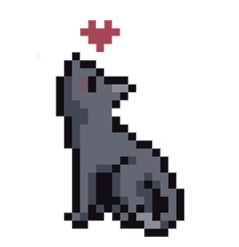

<!-- Improved compatibility of back to top link: See: https://github.com/othneildrew/Best-README-Template/pull/73 -->
<a id="readme-top"></a>

<!-- PROJECT SHIELDS -->
[![Contributors][contributors-shield]][contributors-url]
[![Forks][forks-shield]][forks-url]
[![Stargazers][stars-shield]][stars-url]
[![Issues][issues-shield]][issues-url]
[![LinkedIn][linkedin-shield]][linkedin-url]

<!-- PROJECT LOGO -->
<br />
<div align="center">
  <a href="https://github.com/createlab-univaq/pisco">
    
  </a>

<h2 align="center">PISCO — Godot Game Client</h2>

  <p align="center">
    <strong>2D Top-Down Serious Game RPG Client with Dynamic DAG Clinical Protocol Execution & Physical Behavioral Telemetry</strong>
    <br />
    <br />
    <a href="https://github.com/createlab-univaq/pisco"><strong>Explore the official repository »</strong></a>
    <br />
    <br />
    <a href="https://www.youtube.com/watch?v=pMbj7Mfe42c">View Video Showcase</a>
    &middot;
    <a href="https://github.com/createlab-univaq/pisco/issues">Report Bug</a>
    &middot;
    <a href="https://github.com/createlab-univaq/pisco/issues">Request Feature</a>
  </p>
</div>

> [!IMPORTANT]
> **Repository Snapshot Notice**: This directory is part of a personal snapshot of the PISCO project up to the last commit (`ece164527e3192cb95554e9dd775e8870f734a79` by [CarlinoCalogero](https://github.com/CarlinoCalogero)). The official, ongoing repository of the project is hosted and maintained at **[https://github.com/createlab-univaq/pisco](https://github.com/createlab-univaq/pisco)**.

<!-- TABLE OF CONTENTS -->
<details>
  <summary>Table of Contents</summary>
  <ol>
    <li>
      <a href="#about-the-game-client">About The Game Client</a>
      <ul>
        <li><a href="#built-with">Built With</a></li>
      </ul>
    </li>
    <li>
      <a href="#key-gameplay--technical-systems">Key Gameplay & Technical Systems</a>
      <ul>
        <li><a href="#1-runtime-dag-experiment-parser">Runtime DAG Experiment Parser</a></li>
        <li><a href="#2-physical-dpi-normalized-telemetry-engine">Kinematic Telemetry Engine</a></li>
        <li><a href="#3-standardized-clinical-cognitive-tasks">Clinical Cognitive Tasks</a></li>
        <li><a href="#4-decoupled-multi-modal-dialogue-system">Dialogue System</a></li>
        <li><a href="#5-modular-6-layer-composite-avatar">Composite Avatar Customization</a></li>
        <li><a href="#6-autonomous-pet-ai-bobathecat">Autonomous Pet AI</a></li>
        <li><a href="#7-directional-actionable-interactions">Directional Actionables</a></li>
        <li><a href="#8-jwt-authenticated-cloud-networking">Cloud Networking Layer</a></li>
      </ul>
    </li>
    <li><a href="#directory-structure">Directory Structure</a></li>
    <li>
      <a href="#getting-started">Getting Started</a>
      <ul>
        <li><a href="#prerequisites">Prerequisites</a></li>
        <li><a href="#installation--running">Installation & Running</a></li>
        <li><a href="#controls">Controls</a></li>
        <li><a href="#exporting-builds">Exporting Builds</a></li>
      </ul>
    </li>
    <li><a href="#contact">Contact</a></li>
    <li><a href="#acknowledgments">Acknowledgments</a></li>
  </ol>
</details>

<!-- ABOUT THE GAME CLIENT -->
## About The Game Client

The **PISCO Game Client** is the patient-facing component of the PISCO serious-game platform, developed in Godot 4.6.3. It transforms clinical neuropsychological evaluations into a cozy, 2D top-down pixel-art RPG set inside a virtual home.

Rather than running hard-coded questions, the client functions as a dynamic runtime virtual machine for clinical protocols:
* Patients enter a session redemption code generated by their clinician.
* The game connects to the PISCO backend, downloads the corresponding JSON Directed Acyclic Graph (DAG) constructed in the **Polyglot** editor, and executes it step by step.
* As patients interact with family members, solve Theory of Mind puzzles, read emotional cues, and care for their pet cat, the client transparently logs high-frequency kinematic behavioral telemetry (hesitation reaction time, total response time, and physical centimeters traveled by the cursor).

<p align="right">(<a href="#readme-top">back to top</a>)</p>

### Built With

* [![Godot Engine][Godot.engine]][Godot-url]
* [![GDScript][GDScript.badge]][Godot-url]
* [![Jolt Physics][Jolt.badge]][Jolt-url]
* [![REST API][REST.badge]][REST-url]

<p align="right">(<a href="#readme-top">back to top</a>)</p>

<!-- KEY SYSTEMS -->
## Key Gameplay & Technical Systems

### 1. Runtime DAG Experiment Parser
Located in `system/experiment_manager/`, `ExperimentManager` parses arbitrary JSON flow graphs authored in React Flow.
* **Topological Root Discovery:** Maps graph edges and nodes into adjacency dictionaries, finding the starting node with in-degree 0.
* **Score-Based Conditional Branching:** Dynamically evaluates outgoing edge criteria (`Operator.GREATER_EQUAL`, `LESS_THAN`, etc.) against accumulated patient scores to direct test flow.
* **Dynamic Task Handlers:** Maps node types (`TheoryOfMind`, `BaronCohenFauxPas`, `RMET`, etc.) to decoupled task controllers.

### 2. Physical DPI-Normalized Telemetry Engine
Located in `system/experiment_manager/components/`, the telemetry engine logs granular diagnostic metrics:
* **Dual-Phase Latency:** `FirstInputInterceptor` isolates initial reaction hesitation (time before any input) from `Stopwatch` measuring total time to final decision.
* **Physical Distance Normalization:** `MouseDistanceTracker` queries `DisplayServer.screen_get_dpi()` to convert raw pixel deltas into real-world physical centimeters:
  $$\text{Distance (cm)} = \frac{\Delta \text{pixels}}{\text{DPI}} \times 2.54$$
  This ensures scientific equivalence across diverse monitors and screen resolutions.

### 3. Standardized Clinical Cognitive Tasks
Located in `system/experiment_manager/experiment_nodes/`:
* **Theory of Mind (ToM):** Multi-character narrative scenarios testing belief attribution and social reasoning.
* **Baron-Cohen Faux Pas Recognition:** Assesses awareness of accidental social indiscretions with automated skip logic when no blunder is recognized.
* **Reading the Mind in the Eyes (RMET):** Evaluates complex mental state inference from high-resolution gaze photographs streamed on demand with format sniffing.
* **Emotion Attribution & Recognition:** Open and closed emotional categorization with keyword normalization.

### 4. Decoupled Multi-Modal Dialogue System
Located in `dialogues/`:
* Queue-based `DialogueController` orchestrating typewriter-animated text (`TextBox`), multi-choice buttons (`ChoicesBox`), free-text prompts (`TextInput`), and remote image fetching (`ImageBox`).
* Designed with Godot `@tool` scripts to allow instant live previews within the editor canvas.

### 5. Modular 6-Layer Composite Avatar
Located in `player/`:
* Built using `CompositePlayer` with 6 decoupled visual layers: **Body**, **Face**, **Hair**, **Shirt**, **Pants**, and **Shoes**.
* Supports complete character customization via `CustomPlayerScreen` and syncs animations across 4-directional locomotion via Godot's `AnimationTree` and `BlendTree`.

### 6. Autonomous Pet AI (`BobaTheCat`)
Located in `npcs/cat/`:
* Autonomous domestic cat companion featuring a 3-state Finite State Machine: `IDLE`, `FOLLOW_PLAYER`, and `PET`.
* Uses distance hysteresis thresholds to eliminate jittery start/stop behavior when shadowing the player.
* Emits soothing purr animations and audio when petted, persisting across indoor room transitions.

### 7. Directional Actionable Interactions
Located in `actionables/`:
* Proximity detection triggers using 2D vector dot products to verify the player is looking towards the object before interaction is enabled.
* Sorts overlapping interactables by Euclidean distance and displays an animated exclamation mark indicator.

### 8. JWT-Authenticated Cloud Networking
Located in `api/`:
* `APIManager` handles RESTful communications with the PISCO backend (`analyst-api`).
* Implements JWT Bearer authentication, DTO validation (`GameExecutionDTO`, `RedeemedPathResponseDTO`, `FlowDTO`), automatic retry logic, and user-facing status banners.

<p align="right">(<a href="#readme-top">back to top</a>)</p>

<!-- DIRECTORY STRUCTURE -->
## Directory Structure

```
godot-game/
├── actionables/           # Directional world interaction triggers
├── api/                   # RESTful API client, DTOs, and networking manager
│   └── types/             # GDScript data transfer objects (DTOs)
├── dialogues/             # Asynchronous multi-modal dialogue system & UI components
│   └── components/        # TextBox, ChoicesBox, ImageBox, TextInput
├── fonts/                 # Pixel-art typography assets
├── levels/                # Tilemaps, rooms, and level environments
├── menu/                  # Main menu, session code redemption, character customizer
├── npcs/                  # Non-player characters and autonomous pet AI (BobaTheCat)
├── overlap/               # Hitbox and interaction trigger areas
├── pictures/              # Clinical assessment image cache
├── player/                # Composite 6-layer avatar scripts, animations, and states
├── sprites/               # Pixel-art tilesets, furniture, and spritesheets
└── system/                # Core engines
    ├── experiment_manager/# DAG parser, node handlers, and kinematic telemetry
    ├── game_camera.gd     # Smooth camera controller
    ├── game_state_service # Global runtime state persistence
    └── scene_changer/     # Seamless transitions between scenes
```

<p align="right">(<a href="#readme-top">back to top</a>)</p>

<!-- GETTING STARTED -->
## Getting Started

### Prerequisites

* **Godot Engine 4.6.x (Standard Edition):** Download from [godotengine.org](https://godotengine.org/download).
* Rendering backend compatibility: Vulkan Forward+ or D3D12 (Windows).

### Installation & Running

1. **Clone the repository:**
   ```sh
   git clone https://github.com/createlab-univaq/pisco.git
   cd pisco/godot-game
   ```
2. **Launch Godot Engine:**
   * In the Project Manager, click **Import**.
   * Browse to the `pisco/godot-game` directory and select `project.godot`.
   * Click **Import & Edit**.
3. **Run the Project:**
   * Press **F5** (or click the **Play** button in the top right corner) to start the game.
   * Enter a valid redemption code or use the offline debug testing scene.

### Controls

| Action | Keyboard / Mouse | Gamepad |
|---|---|---|
| **Move Up / Down / Left / Right** | `W` `A` `S` `D` or Arrow Keys | Left Analog Stick / D-Pad |
| **Interact / Advance Dialogue** | `Z` / `Space` / `Enter` | `A` Button (Xbox) / `Cross` (PlayStation) |
| **Select Dialogue / Clinical Choice** | Mouse Left Click | Left Stick + `A` |
| **Menu / Pause** | `Esc` | `Start` Button |

### Exporting Builds

The project includes pre-configured export presets in `export_presets.cfg`:
* **Windows Desktop (x86_64):** Standalone executable with embedded PCK or separate `.pck`.
* **macOS:** Universal `.app` bundle.
* **Linux:** Standalone x86_64 ELF binary.

To export from the Godot editor:
1. Navigate to **Project** -> **Export...**
2. Select your target operating system preset.
3. Click **Export Project** and select your output destination.

<p align="right">(<a href="#readme-top">back to top</a>)</p>

<!-- CONTACT -->
## Contact

* **Calogero Carlino** - Lead Game Developer & Systems Architect
  * Email: [carlinocalogero.dev@gmail.com](mailto:carlinocalogero.dev@gmail.com)
  * Portfolio: [https://carlinocalogero.github.io](https://carlinocalogero.github.io)
  * LinkedIn: [https://www.linkedin.com/in/calogero-carlino-2a94a33b5/](https://www.linkedin.com/in/calogero-carlino-2a94a33b5/)
  * GitHub: [@CarlinoCalogero](https://github.com/CarlinoCalogero)
* **CreateLab UNIVAQ** - [https://github.com/createlab-univaq](https://github.com/createlab-univaq)
* **Project Link:** [https://github.com/createlab-univaq/pisco](https://github.com/createlab-univaq/pisco)

<p align="right">(<a href="#readme-top">back to top</a>)</p>

<!-- ACKNOWLEDGMENTS -->
## Acknowledgments

* [CreateLab - University of L'Aquila](https://github.com/createlab-univaq)
* [Godot Engine](https://godotengine.org/)
* [Jolt Physics for 3D/2D](https://github.com/godot-jolt/godot-jolt)
* [Best-README-Template](https://github.com/othneildrew/Best-README-Template)

<p align="right">(<a href="#readme-top">back to top</a>)</p>

<!-- MARKDOWN LINKS & IMAGES -->
[contributors-shield]: https://img.shields.io/github/contributors/createlab-univaq/pisco.svg?style=for-the-badge
[contributors-url]: https://github.com/createlab-univaq/pisco/graphs/contributors
[forks-shield]: https://img.shields.io/github/forks/createlab-univaq/pisco.svg?style=for-the-badge
[forks-url]: https://github.com/createlab-univaq/pisco/network/members
[stars-shield]: https://img.shields.io/github/stars/createlab-univaq/pisco.svg?style=for-the-badge
[stars-url]: https://github.com/createlab-univaq/pisco/stargazers
[issues-shield]: https://img.shields.io/github/issues/createlab-univaq/pisco.svg?style=for-the-badge
[issues-url]: https://github.com/createlab-univaq/pisco/issues
[linkedin-shield]: https://img.shields.io/badge/-LinkedIn-black.svg?style=for-the-badge&logo=linkedin&colorB=555
[linkedin-url]: https://www.linkedin.com/in/calogero-carlino-2a94a33b5/

[Godot.engine]: https://img.shields.io/badge/Godot_4.6-478CBF?style=for-the-badge&logo=godotengine&logoColor=white
[Godot-url]: https://godotengine.org/
[GDScript.badge]: https://img.shields.io/badge/GDScript-478CBF?style=for-the-badge&logo=godotengine&logoColor=white
[Jolt.badge]: https://img.shields.io/badge/Physics-Jolt-orange?style=for-the-badge
[Jolt-url]: https://github.com/godot-jolt/godot-jolt
[REST.badge]: https://img.shields.io/badge/REST-API_Client-blue?style=for-the-badge
[REST-url]: https://restfulapi.net/
