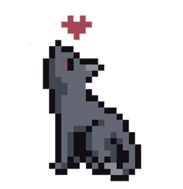

<!-- Improved compatibility of back to top link: See: https://github.com/othneildrew/Best-README-Template/pull/73 -->
<a id="readme-top"></a>

<!-- PROJECT SHIELDS -->
[![Contributors][contributors-shield]][contributors-url]
[![Forks][forks-shield]][forks-url]
[![Stargazers][stars-shield]][stars-url]
[![Issues][issues-shield]][issues-url]
[![LinkedIn][linkedin-shield]][linkedin-url]

<!-- PROJECT LOGO -->
<br />
<div align="center">
  <a href="https://github.com/createlab-univaq/pisco">
    
  </a>

<h2 align="center">PISCO — Polyglot DAG Protocol Editor</h2>

  <p align="center">
    <strong>Visual Graph-Based Cognitive Protocol Authoring Environment for Clinicians and Neuroscientists</strong>
    <br />
    <br />
    <a href="https://github.com/createlab-univaq/pisco"><strong>Explore the official repository »</strong></a>
    <br />
    <br />
    <a href="https://github.com/createlab-univaq/pisco/issues">Report Bug</a>
    &middot;
    <a href="https://github.com/createlab-univaq/pisco/issues">Request Feature</a>
  </p>
</div>

> [!IMPORTANT]
> **Repository Snapshot Notice**: This directory is part of a personal snapshot of the PISCO project up to the last commit (`ece164527e3192cb95554e9dd775e8870f734a79` by [CarlinoCalogero](https://github.com/CarlinoCalogero)). The official, ongoing repository of the project is hosted and maintained at **[https://github.com/createlab-univaq/pisco](https://github.com/createlab-univaq/pisco)**.

<!-- TABLE OF CONTENTS -->
<details>
  <summary>Table of Contents</summary>
  <ol>
    <li>
      <a href="#about-polyglot">About Polyglot</a>
      <ul>
        <li><a href="#built-with">Built With</a></li>
      </ul>
    </li>
    <li>
      <a href="#core-capabilities">Core Capabilities</a>
      <ul>
        <li><a href="#visual-flow-design">Visual Flow Design</a></li>
        <li><a href="#clinical-node-types">Clinical Node Types</a></li>
        <li><a href="#conditional-branching--validation">Conditional Branching & Validation</a></li>
      </ul>
    </li>
    <li>
      <a href="#getting-started">Getting Started</a>
      <ul>
        <li><a href="#prerequisites">Prerequisites</a></li>
        <li><a href="#installation--configuration">Installation & Configuration</a></li>
        <li><a href="#development-server">Development Server</a></li>
        <li><a href="#docker-deployment">Docker Deployment</a></li>
      </ul>
    </li>
    <li><a href="#extending-polyglot-adding-nodes">Extending Polyglot (Adding Nodes)</a></li>
    <li><a href="#contact">Contact</a></li>
    <li><a href="#acknowledgments">Acknowledgments</a></li>
  </ol>
</details>

<!-- ABOUT POLYGLOT -->
## About Polyglot

**Polyglot** is the clinical protocol design environment for the PISCO serious game platform. Built with **Next.js 16**, **React 19**, and **React Flow**, it provides cognitive researchers and psychologists with an intuitive visual canvas to author complex, branching neuropsychological evaluation flows without writing any code.

In clinical practice, static questionnaires cannot dynamically adapt to a patient's cognitive fatigue or specific deficits. Polyglot allows researchers to:
1. Connect standardized cognitive exercises (Theory of Mind, Baron-Cohen Faux Pas, RMET) into Directed Acyclic Graphs (DAGs).
2. Configure score thresholds and conditional edges that determine the next task at runtime.
3. Export and publish verified JSON graph payloads directly to the PISCO backend, which the **Godot Game Client** downloads and executes in real time.

<p align="right">(<a href="#readme-top">back to top</a>)</p>

### Built With

* [![Next.js][Next.js]][Next-url]
* [![React][React.js]][React-url]
* [![React Flow][ReactFlow.badge]][ReactFlow-url]
* [![TypeScript][TypeScript.badge]][TypeScript-url]
* [![Monaco Editor][Monaco.badge]][Monaco-url]
* [![Docker][Docker.badge]][Docker-url]

<p align="right">(<a href="#readme-top">back to top</a>)</p>

<!-- CORE CAPABILITIES -->
## Core Capabilities

### Visual Flow Design
* **Interactive Canvas:** Built on React Flow with pan, zoom, minimap, auto-snapping, and drag-and-drop node placement.
* **Property Inspector:** Contextual sidebar powered by `@monaco-editor/react` and custom property editors to tune question texts, answer choices, and asset URLs.
* **In-Degree Root Discovery Compliance:** Guarantees that the flow has a well-defined starting node (in-degree = 0) and non-cyclical evaluation paths.

### Clinical Node Types
* **Theory of Mind (ToM) Nodes:** Story-driven scenarios presenting social interactions and assessing false belief understanding.
* **Baron-Cohen Faux Pas Recognition Nodes:** Complex social mistake detection with automated sub-question skipping logic.
* **Reading the Mind in the Eyes (RMET) Nodes:** Standardized eye-region photographs with 4 emotional state descriptors.
* **Container Nodes:** Group related exercises into composite clinical test batteries.

### Conditional Branching & Validation
* **Score-Driven Edges:** Edges can evaluate patient score conditions (`>`, `>=`, `<`, `<=`, `==`) to navigate the player to adaptive follow-up tasks or remedial exercises.
* **Validation Engine:** `nodeValidator.ts` and `conditionalEdgeValidator.ts` check the graph for missing connections, unconfigured properties, or malformed score bounds before saving.

<p align="right">(<a href="#readme-top">back to top</a>)</p>

<!-- GETTING STARTED -->
## Getting Started

### Prerequisites

* **Node.js:** Version 20.x or higher
* **npm:** Version 10.x or higher (or pnpm / yarn)

### Installation & Configuration

1. **Clone the repository:**
   ```sh
   git clone https://github.com/createlab-univaq/pisco.git
   cd pisco/polyglot
   ```

2. **Install dependencies:**
   ```sh
   npm install
   ```

3. **Configure environment variables:**
   Copy `.env.example` to `.env.local`:
   ```sh
   cp .env.example .env.local
   ```
   Configure the following keys:
   ```env
   # API Endpoint (accessible in client components)
   NEXT_PUBLIC_API_BASE_URL="http://localhost:8082/api"

   # Mock Data Toggle:
   # Set to true for offline development without a running backend
   USE_MOCK_DATA=true

   # Maximum image upload size
   MAX_UPLOAD_SIZE=10mb
   ```

### Development Server

Run the Next.js development server:
```sh
npm run dev
```

Open [http://localhost:3000](http://localhost:3000) with your browser to view the editor.

### Docker Deployment

Polyglot includes a production multi-stage `Dockerfile` and `docker-compose.yml`:
```sh
docker compose up -d
```

<p align="right">(<a href="#readme-top">back to top</a>)</p>

<!-- EXTENDING POLYGLOT -->
## Extending Polyglot (Adding Nodes)

Adding a new cognitive task to the canvas requires registering the component with Polyglot's type system:

1. **Define Identifier:** Add your node type to `src/types/NodeType.ts`.
2. **Create Node Folder:** Under `src/components/nodes/<YourNewNode>/`, create:
   * `types.ts` — TypeScript interfaces for node properties.
   * `YourNewNodeProperties.tsx` — Right sidebar property editor.
   * `ReactFlowYourNewNode.tsx` — Canvas display component.
   * `validate.ts` — Custom validation rules.
   * `index.ts` — Node registration config.
3. **Register Node:** Add the configuration to `src/components/nodes/ElementMapping.ts`.
4. **Update Global Union:** Include the interface in `src/types/PolyglotNode.ts`.

For complete details, see [`DEVELOPMENT.md`](./DEVELOPMENT.md).

<p align="right">(<a href="#readme-top">back to top</a>)</p>

<!-- CONTACT -->
## Contact

* **Calogero Carlino** - Game Programmer & Systems Architect
  * Email: [carlinocalogero.dev@gmail.com](mailto:carlinocalogero.dev@gmail.com)
  * Portfolio: [https://carlinocalogero.github.io](https://carlinocalogero.github.io)
  * LinkedIn: [https://www.linkedin.com/in/calogero-carlino-2a94a33b5/](https://www.linkedin.com/in/calogero-carlino-2a94a33b5/)
  * GitHub: [@CarlinoCalogero](https://github.com/CarlinoCalogero)
* **CreateLab UNIVAQ** - [https://github.com/createlab-univaq](https://github.com/createlab-univaq)
* **Project Repository:** [https://github.com/createlab-univaq/pisco](https://github.com/createlab-univaq/pisco)

<p align="right">(<a href="#readme-top">back to top</a>)</p>

<!-- ACKNOWLEDGMENTS -->
## Acknowledgments

* [CreateLab - University of L'Aquila](https://github.com/createlab-univaq)
* [React Flow](https://reactflow.dev/)
* [Next.js by Vercel](https://nextjs.org/)
* [Best-README-Template](https://github.com/othneildrew/Best-README-Template)

<p align="right">(<a href="#readme-top">back to top</a>)</p>

<!-- MARKDOWN LINKS & IMAGES -->
[contributors-shield]: https://img.shields.io/github/contributors/CarlinoCalogero/pisco.svg?style=for-the-badge
[contributors-url]: https://github.com/CarlinoCalogero/pisco/graphs/contributors
[forks-shield]: https://img.shields.io/github/forks/CarlinoCalogero/pisco.svg?style=for-the-badge
[forks-url]: https://github.com/CarlinoCalogero/pisco/network/members
[stars-shield]: https://img.shields.io/github/stars/CarlinoCalogero/pisco.svg?style=for-the-badge
[stars-url]: https://github.com/CarlinoCalogero/pisco/stargazers
[issues-shield]: https://img.shields.io/github/issues/CarlinoCalogero/pisco.svg?style=for-the-badge
[issues-url]: https://github.com/CarlinoCalogero/pisco/issues
[linkedin-shield]: https://img.shields.io/badge/-LinkedIn-black.svg?style=for-the-badge&logo=linkedin&colorB=555
[linkedin-url]: https://www.linkedin.com/in/calogero-carlino-2a94a33b5/

[Next.js]: https://img.shields.io/badge/Next.js_16-000000?style=for-the-badge&logo=nextdotjs&logoColor=white
[Next-url]: https://nextjs.org/
[React.js]: https://img.shields.io/badge/React_19-20232A?style=for-the-badge&logo=react&logoColor=61DAFB
[React-url]: https://react.dev/
[ReactFlow.badge]: https://img.shields.io/badge/React_Flow-FF0072?style=for-the-badge&logo=reactflow&logoColor=white
[ReactFlow-url]: https://reactflow.dev/
[TypeScript.badge]: https://img.shields.io/badge/TypeScript-3178C6?style=for-the-badge&logo=typescript&logoColor=white
[TypeScript-url]: https://www.typescriptlang.org/
[Monaco.badge]: https://img.shields.io/badge/Monaco_Editor-1E1E1E?style=for-the-badge
[Monaco-url]: https://microsoft.github.io/monaco-editor/
[Docker.badge]: https://img.shields.io/badge/Docker-2496ED?style=for-the-badge&logo=docker&logoColor=white
[Docker-url]: https://www.docker.com/
